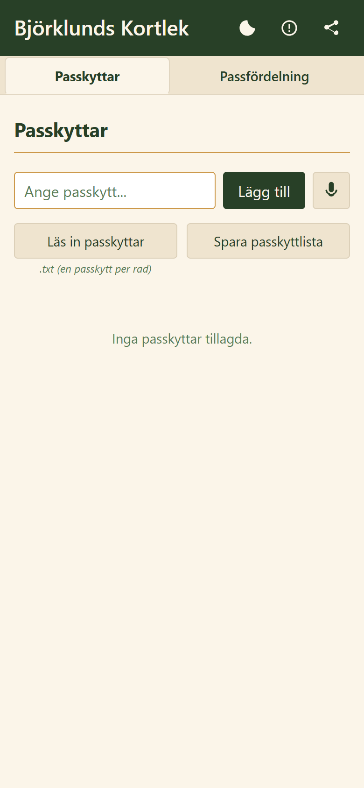
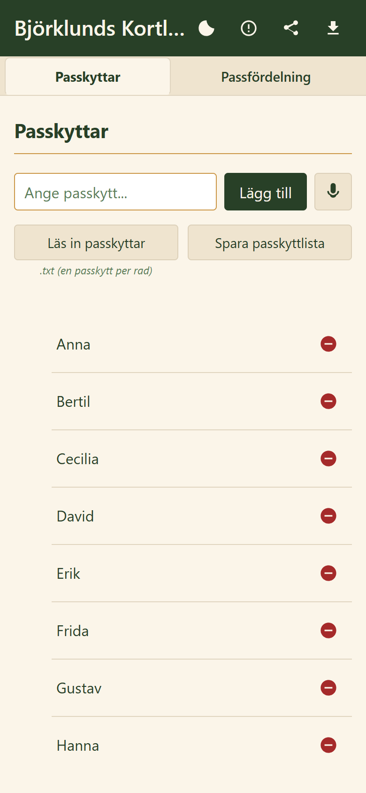
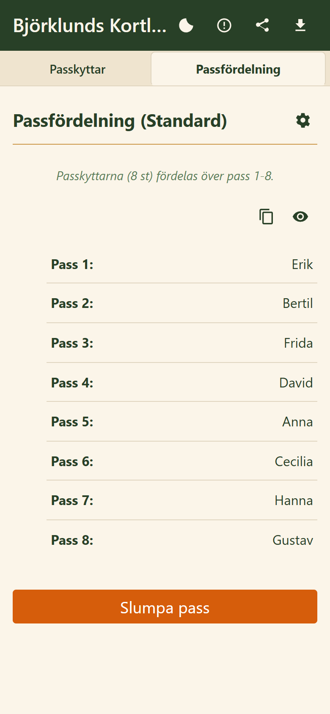

# Björklunds Kortlek

[](https://github.com/Stevoxa/bjorklunds-kortlek/actions/workflows/test.yml)

En webbapp för jaktlag som slumpar passfördelningen inför ett såt. Du lägger in dagens passkyttar, trycker på **Slumpa pass** och får en lista över vem som står på vilket pass.

**Öppna appen:** <https://stevoxa.github.io/bjorklunds-kortlek/>

<p>
  
  
  
</p>

## Varför slumpa passen?

Vid jakt med drev står skyttarna på pass, alltså fasta platser längs drevet. Vissa pass ger mer vilt än andra. Lottar man passen blir fördelningen rättvis, och ingen behöver diskutera vem som fick det bästa passet förra gången. Appen ersätter kortleken eller lapparna i mössan.

## Funktioner

- **Standardläge:** skyttarna fördelas över Pass 1 till n, ett pass var.
- **Avancerat läge:** lägg in lagets egna pass, t.ex. `Tornet`, `Bäcken` och `12`. Finns det fler pass än skyttar markeras de överblivna som *Ledigt*. Finns det färre visas skyttarna som inte fick plats som *Oplacerade*.
- **Röstinmatning** av namn och pass, i webbläsare som stöder det.
- **Listor som filer:** läs in och spara skyttar och pass som `.txt`, en per rad.
- **Kopiera resultatet** och klistra in det i lagets chatt.
- **Eget lagnamn:** lägg till `?team=Ditt Lagnamn` i adressen. Då visar appen ert namn, och Dela-knappen skapar en länk och QR-kod som innehåller namnet.
- **Fungerar utan täckning:** appen kan installeras på hemskärmen. Efter första besöket fungerar den offline.
- Ljust och mörkt tema.

## Integritet

Namn och pass sparas bara i webbläsaren på den egna enheten (`localStorage`) och skickas inte vidare. Appen använder Google Analytics för anonym användningsstatistik, till exempel vilka funktioner som används. Mer om detta finns under Hjälp i appen.

## Teknik

Appen är byggd med vanlig HTML, CSS och JavaScript, utan ramverk och utan byggsteg. Den publiceras med GitHub Pages direkt från `main`.

| Fil | Innehåll |
| --- | --- |
| `index.html` | Hela gränssnittet: markup, stilar och applogik |
| `passes.js` | Själva lottningen (Fisher–Yates-blandning och fördelning på pass) |
| `sw.js` | Service worker. Hämtar alltid senaste versionen när nätet finns och faller tillbaka på cachen offline eller vid svag täckning. |
| `manifest.json` | PWA-manifest för installation på hemskärmen |
| `styleguide.html` | Appens stilguide med färger, typografi och komponenter i ljust och mörkt tema. Används som referens när gränssnittet ändras. [Visa live](https://stevoxa.github.io/bjorklunds-kortlek/styleguide.html). |

### Köra lokalt

Service workern kräver en webbserver, så det räcker inte att öppna filen direkt i webbläsaren:

```bash
python -m http.server 8000
```

Öppna sedan <http://localhost:8000>.

### Tester

Testerna gäller lottningen: att alla skyttar får exakt ett pass, att ingen förekommer två gånger, hur lediga och oplacerade hanteras och att blandningen är jämnt fördelad. De kräver Node 18 eller senare och inga beroenden:

```bash
node --test
```

Testerna körs automatiskt i GitHub Actions vid varje push och pull request.

### Publicera en ny version

Höj `CACHE_NAME` i `sw.js` när listan över cachade filer ändras. Övriga ändringar når användarna automatiskt vid nästa besök med nätanslutning.

## Licens

[MIT](LICENSE)
